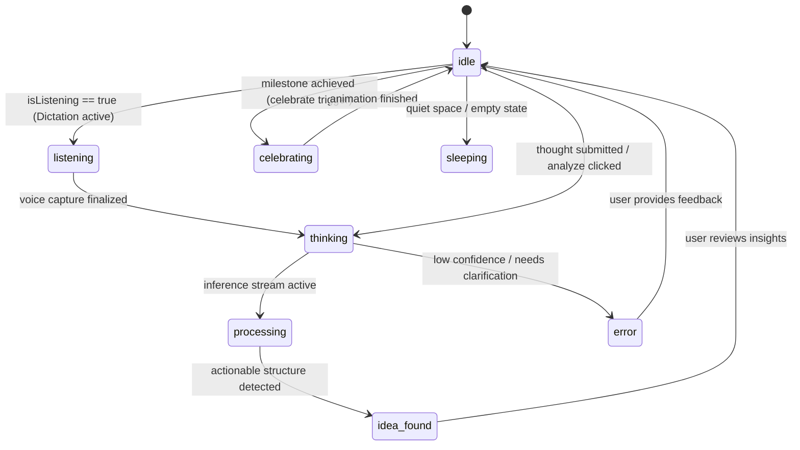

# MARGIN — Midnight Bloom

> **"Think freely. Make things happen."**  
> A personal journal, intelligent workspace, and creative companion designed around **Soft Intelligence** and **Mindful Privacy**.

[](https://flutter.dev)
[](https://dart.dev)
[](#design-tokens)
[](LICENSE)

---

## 🌸 Visual Direction: Midnight Bloom

MARGIN moves away from generic dashboard grids and harsh OLED black interfaces. **Midnight Bloom** is an intimate, warm, softly illuminated creative sanctuary:

- **Deep Charcoal Foundations**: `#111114` scaffold, `#1B1B21` card surfaces, and `#25252D` elevated inputs.
- **Atmospheric Pastel Accents**: 
  - **Lavender** (`#BCA5FF`) — Identity, primary navigation, focus outlines
  - **Peach** (`#FFBFAF`) — Idea sparks, high priority, warmth
  - **Mint** (`#A9E5CF`) — Verified privacy, on-device AI status, momentum
  - **Butter** (`#FFE599`) — Discovery stars, glints, attention markers
  - **Sky** (`#B4DCFF`) — Shared collaboration, cloud reasoning
- **Editorial Typography**: 
  - **Quicksand** — Warm headings, navigation, and friendly labels.
  - **Inter** — High-legibility dense thought text and metadata.
- **Structural Restraint**: 1px subtle architectural borders (`#2B2B36`) replace heavy drop shadows.

---

## 🪐 Meet Margo: Interactive Companion & State Machine

Margo is not a set of static illustrations—she is a cohesive vector-rendered animated character driven by a reactive state machine that strictly reflects real application events:



### State Machine Inputs
- `mood` *(Enum)*: `idle`, `listening`, `thinking`, `processing`, `idea_found`, `celebrating`, `sleeping`, `error`.
- `isListening` *(Boolean)*: Activates attentive posture, lavender headphones, and audio waveform reaction.
- `isProcessing` *(Boolean)*: Accelerates the orbiting iridescent ribbon and particle stars. Margo **never fakes success** while inference is ongoing.
- `progress` *(Number 0.0 → 1.0)*: Multi-stage reasoning stream indicator.
- `celebrate` *(Trigger)*: Triggers joyful celebration jump upon milestone completion.

---

## ⚡ The Functional Data Flow

MARGIN follows an explicit behavioral contract where AI acts as a thought partner, never an automated dictator:

```
1. Thought Capture (Text / Dictation / Audio Memo)
        │
        ▼
2. Save Original Journal Entry (Preserved as immutable source of truth)
        │
        ▼
3. Hybrid Inference Engine
   ├── Local On-Device AI (Fast categorization, tags, basic task extraction)
   └── Cloud Fallback AI (Deep strategic blueprints, risk mitigations)
        │
        ▼
4. Structured Insights Review
   ├── Detected Project Opportunities
   ├── Editable & Removable Key Points
   └── Selectable Action Plan Checklist (0 of N selected)
        │
        ▼
5. User Confirmation Sheet (Explicit approval gate — zero silent actions)
        │
        ▼
6. Workspace Synchronized
   └── Projects and tasks created, linked back to the original journal entry
```

---

## 📱 Navigation & Screen Architecture

MARGIN is built mobile-first with responsive tablet/desktop canvas support:

1. **Phase A — First Launch**:
   - `SplashScreen`: Lavender-to-charcoal gradient with floating Margo and logo fade-in.
   - `WelcomeScreen`: Editorial intro (*"Your thoughts deserve somewhere to go"*).
   - `OnboardingScreen`: 3 interactive slides with Margo mood morphing.
   - `PermissionsScreen`: Transparent microphone, reminder, and local AI consent.
   - `AuthScreen`: Instant personalized workspace creation without rigid role lock-in.

2. **Phase B — Main Workspace**:
   - `HomeDashboardScreen`: Editorial motto (*"Make room for what matters"*), capture hero, horizontal project cards, and today's priority list.
   - `JournalScreen`: Chronological thought archive with filter chips (`All`, `Voice`, `Analyzed`, `Projects`, `Drafts`).
   - `ThoughtCaptureScreen`: Distraction-free text editor + live voice recorder with dynamic waveforms.
   - `SavedEntryScreen`: Source-of-truth viewer with metadata tags and one-tap re-analysis.

3. **Phase C — The Intelligence Experience**:
   - `AIAnalysisScreen`: Multi-stage reasoning feedback stream.
   - `AIInsightsScreen`: Detected ideas, editable key points, and selectable action plans.
   - `ProjectBlueprintScreen`: Strategic architecture with scope guardrails, milestone timeline, risk mitigation, and approval toggles.

4. **Phase D — Execution & Priority**:
   - `ProjectsScreen`: Grid/list with progress meters and member stacks.
   - `ProjectDetailScreen`: Tabs for Overview, Tasks, Journal, and Decisions.
   - `TasksScreen`: Segmented filters (`All`, `Today`, `Upcoming`, `Completed`).
   - `PrioritiesScreen`: Smart Attention Insights with user-controlled focus switching.

5. **Phase E & F — Collaboration & Long-Term Use**:
   - `TeamsScreen`: Shared discussion where Margo's AI proposals are clearly distinct from human team messages.
   - `InviteMembersSheet`: Role-based permissions (`Admin`, `Member`, `Viewer`).
   - `NotificationsScreen`: Reminders, mentions, and insight alerts.
   - `GlobalSearchScreen`: Unified cross-entity search across notes, projects, and tasks.
   - `SettingsScreen`: Theme toggle, hybrid local-first AI preference, and privacy controls.
   - `CelebrationScreen`: Milestone achievement celebration with jumping Margo.

---

## 🛠️ Getting Started

### Prerequisites
- [Flutter SDK](https://flutter.dev/docs/get-started/install) (v3.47+ recommended)
- Dart SDK (v3.13+)

### Run Locally
```bash
# Clone the repository
git clone https://github.com/Abdul-Hafiz-1/Margin2.git
cd Margin2

# Install dependencies
flutter pub get

# Run static analysis
flutter analyze

# Run unit and widget test suite
flutter test

# Run application on your preferred device (Windows, Android, Web, macOS)
flutter run
```

---

## 📄 License
This project is licensed under the MIT License — see the [LICENSE](LICENSE) file for details.
